# Azure Sentinel Honeypot SOC Lab

I built a small SOC lab in Microsoft Azure to practice how security analysts work. I put a Windows Server VM on the internet with RDP open on purpose, sent its security logs to Microsoft Sentinel, and used KQL to hunt for attacks. I also built a detection rule that creates incidents automatically, tuned it, and closed the incidents. Within the first night, a known malicious IP from Romania tried to log in.

**Tools:** Microsoft Sentinel, Log Analytics, KQL, Azure Monitor Agent, Data Collection Rules, Azure CLI, Windows Server 2022, AbuseIPDB, VirusTotal
**Framework:** MITRE ATT&CK T1110 (Brute Force)

---

## How it works

```
Attackers on the internet
        |
        |  RDP login attempts (port 3389)
        v
Windows Server 2022 VM (honeypot)
        |
        |  Windows Security Events (4625 failed / 4624 successful logins)
        v
Azure Monitor Agent  -->  Data Collection Rule
        |
        v
Log Analytics workspace  -->  Microsoft Sentinel
        |
        +--> KQL threat hunting
        +--> Scheduled detection rule  -->  Incidents
```

---

## 1. Setup

I built most of the lab with Azure CLI in Cloud Shell.

```bash
# Resource group and Log Analytics workspace
az group create -n rg-soc-lab -l northcentralus
az monitor log-analytics workspace create -g rg-soc-lab -n law-soc-lab -l northcentralus

# Windows Server VM with RDP open to the internet (the honeypot)
az vm create -g rg-soc-lab -n vm-honeypot --image Win2022Datacenter \
  --size Standard_B2as_v2 --admin-username labadmin \
  --public-ip-sku Standard --nsg-rule RDP

# Azure Monitor Agent (the VM needs a managed identity for the agent to send data)
az vm identity assign -g rg-soc-lab -n vm-honeypot
az vm extension set -g rg-soc-lab --vm-name vm-honeypot \
  -n AzureMonitorWindowsAgent --publisher Microsoft.Azure.Monitor
```

Then I created a Data Collection Rule that sends **all Windows Security events** (`Security!*`) to the `SecurityEvent` table in Sentinel, and linked it to the VM.

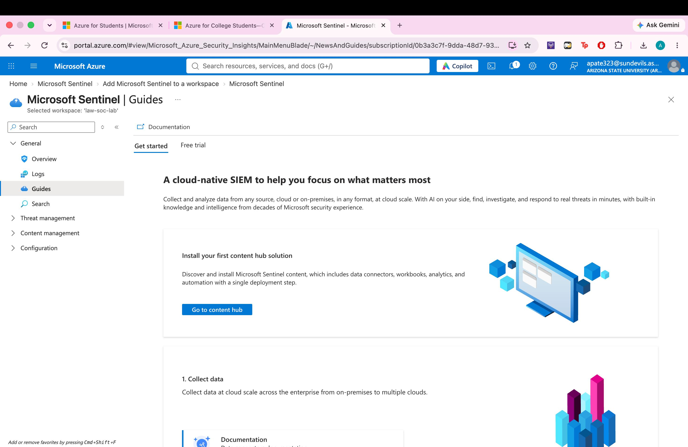
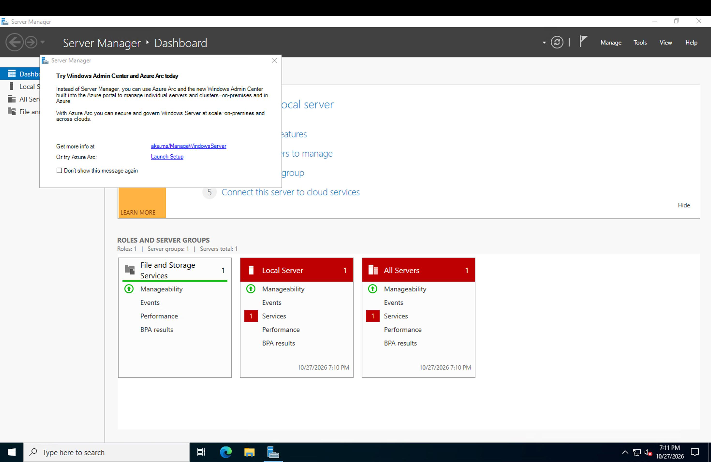
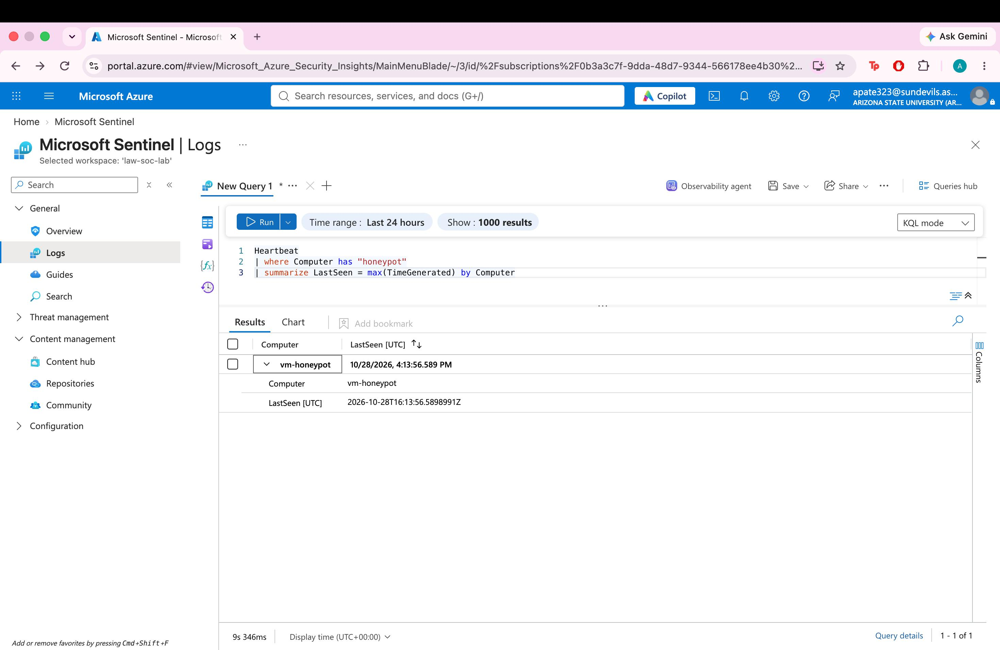

**Problem I hit:** No logs showed up at first. The agent was installed, but the VM didn't have a managed identity, so the agent couldn't authenticate. Assigning a system-assigned identity and restarting the VM fixed it.

---

## 2. Testing the pipeline

I logged into the VM from my Mac, then entered a wrong password 4 times. All 4 failed logins (Event ID 4625) showed up in Sentinel within about 10 minutes.

```kql
SecurityEvent
| where EventID == 4625
| project TimeGenerated, Account, IpAddress, LogonType, Computer
| order by TimeGenerated desc
```

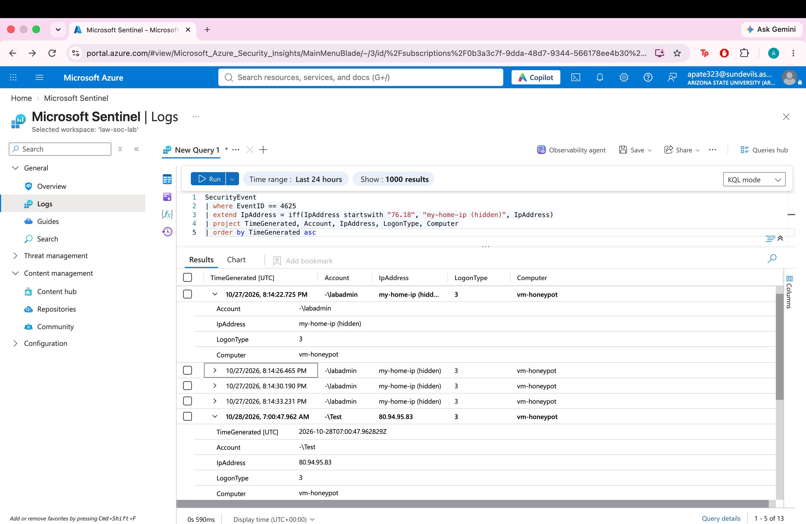

---

## 3. Threat hunting with KQL

**Overview of attempts**
```kql
SecurityEvent
| where EventID == 4625
| summarize Attempts = count(), UniqueIPs = dcount(IpAddress),
            FirstSeen = min(TimeGenerated), LastSeen = max(TimeGenerated)
```

**Top attacker IPs with location**
```kql
SecurityEvent
| where EventID == 4625 and isnotempty(IpAddress) and IpAddress != "-"
| summarize Attempts = count(), UsernamesTried = dcount(Account) by IpAddress
| extend Geo = geo_info_from_ip_address(IpAddress)
| extend Country = tostring(Geo.country), City = tostring(Geo.city)
| project IpAddress, Country, City, Attempts, UsernamesTried
| order by Attempts desc
```

**Usernames attackers tried**
```kql
SecurityEvent
| where EventID == 4625
| summarize Attempts = count() by Account
| top 15 by Attempts
```

**Attacks by country**
```kql
SecurityEvent
| where EventID == 4625 and isnotempty(IpAddress) and IpAddress != "-"
| extend Country = tostring(geo_info_from_ip_address(IpAddress).country)
| summarize Attempts = count() by Country
| order by Attempts desc
```

**Attacks over time**
```kql
SecurityEvent
| where EventID == 4625
| summarize Attempts = count() by bin(TimeGenerated, 1h)
| render timechart
```

**Did any attacker log in successfully?**
```kql
let attackers = SecurityEvent | where EventID == 4625 | distinct IpAddress;
SecurityEvent
| where EventID == 4624 and LogonType in (3, 10)
| where IpAddress in (attackers)
| project TimeGenerated, Account, IpAddress, LogonType
```
Result: **no successful logins from any attacker IP.**

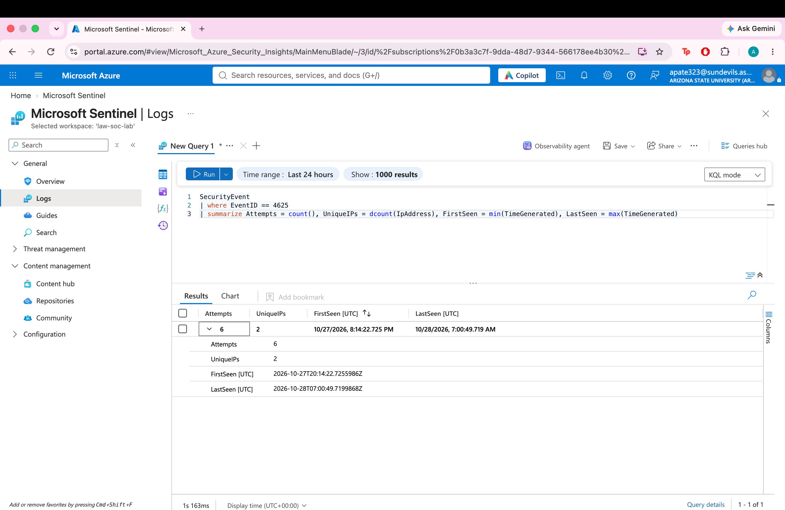
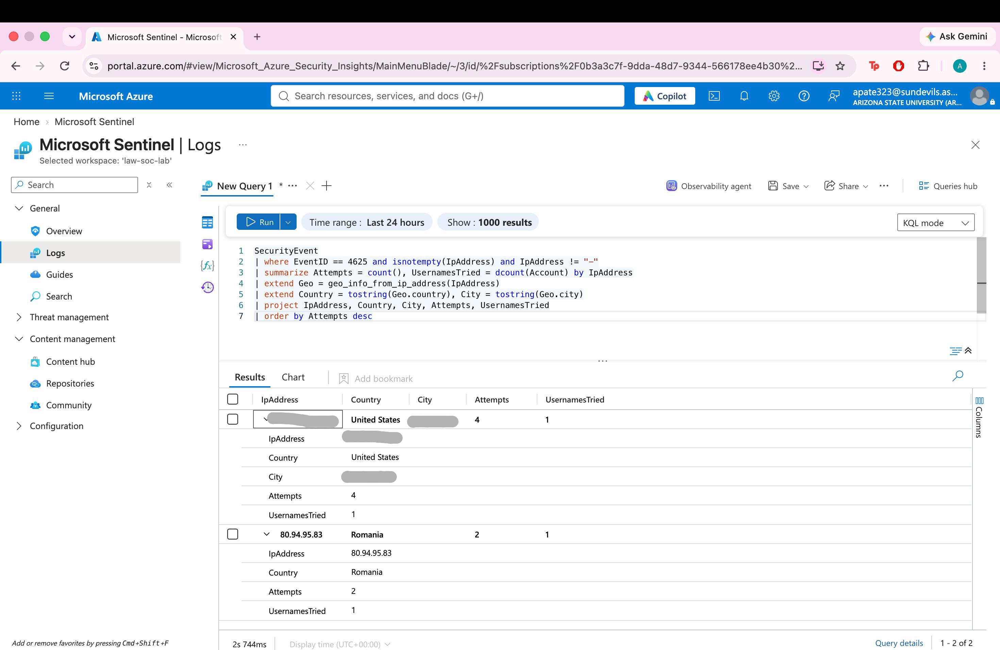
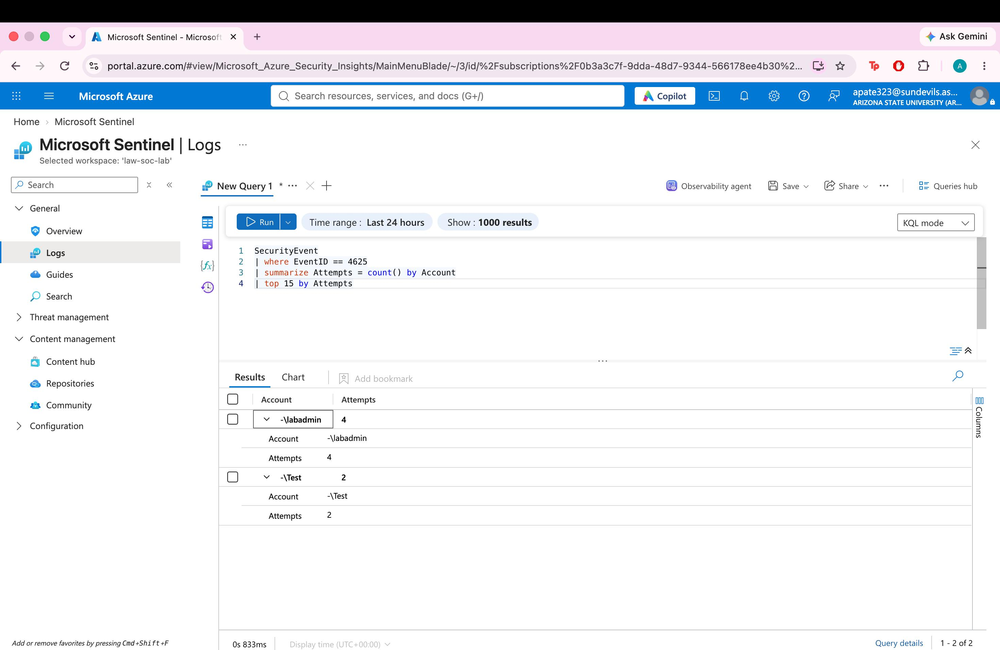
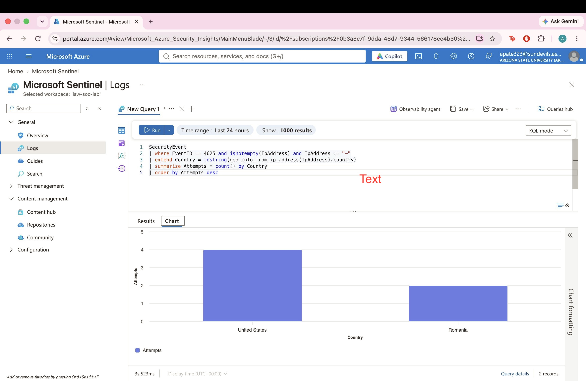
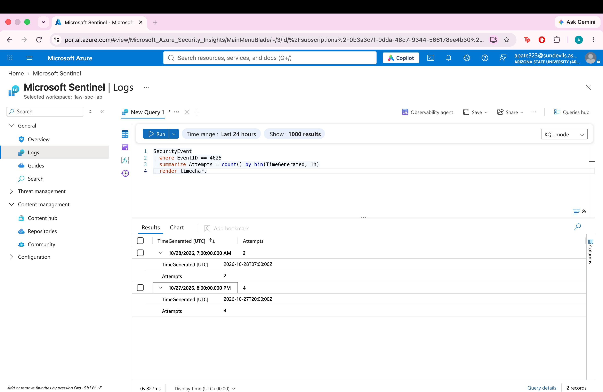
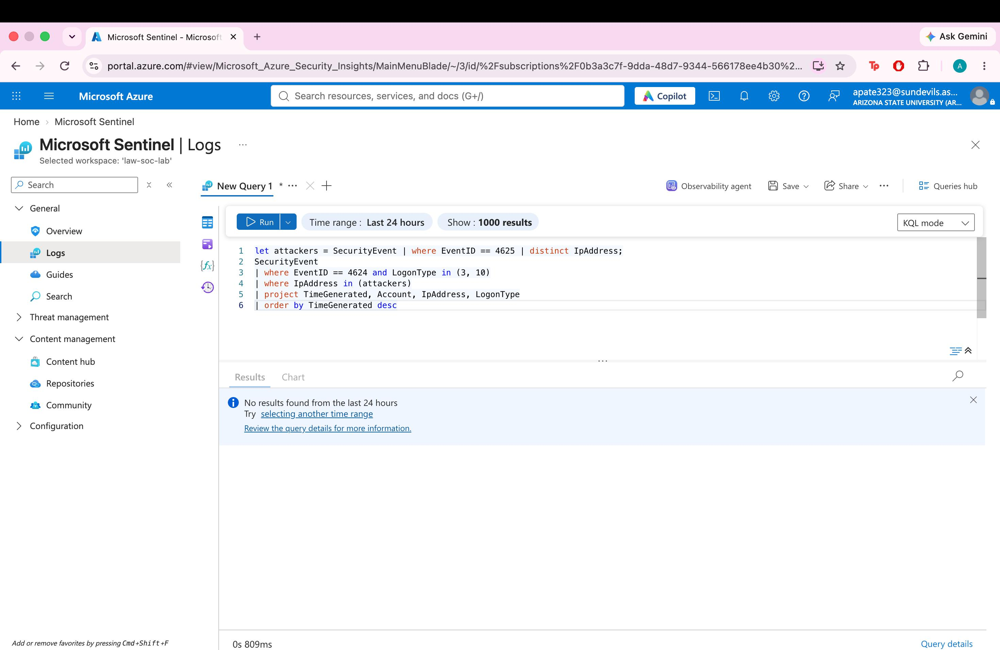

---

## 4. Incident: brute-force attempt from a known malicious IP

| | |
|---|---|
| **When** | Oct 28, 2026, 07:00 UTC (overnight, first night online) |
| **Source IP** | 80.94.95.83, Timisoara, Romania (AS204428 UNMANAGED LTD, hosting provider) |
| **Target** | vm-honeypot, RDP port 3389 |
| **Activity** | 2 failed logins (Event ID 4625) with username `Test` |
| **Successful?** | No. No Event ID 4624 from this IP |
| **AbuseIPDB** | 100% abuse confidence, 8,669 reports from 368 reporters |
| **VirusTotal** | 13 of 92 vendors flagged it as malicious |
| **MITRE ATT&CK** | T1110 Brute Force (Credential Access) |

**Analysis:** The IP belongs to a data center, not a home user. Its reputation and the default username (`Test`) point to an automated scanning bot that tries common usernames on exposed RDP servers. I reported the IP to AbuseIPDB under Brute-Force.

**What I would do in a real environment:** block the IP in the network security group, restrict RDP to trusted IPs or use a VPN or Azure Bastion, turn on account lockout, and require MFA for remote access.

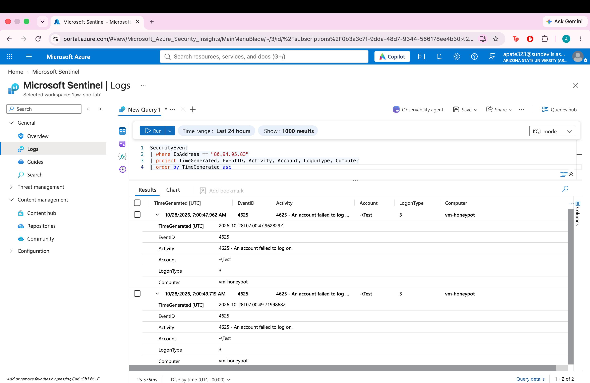

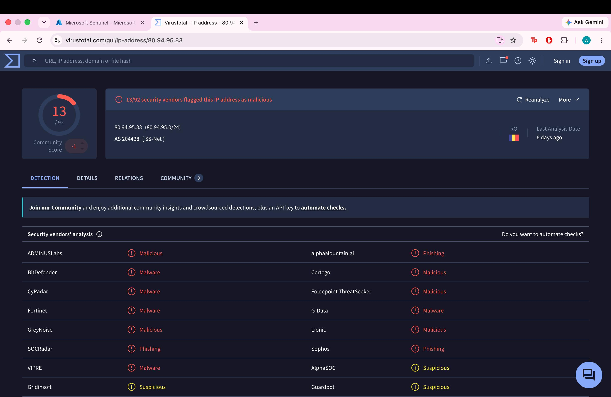
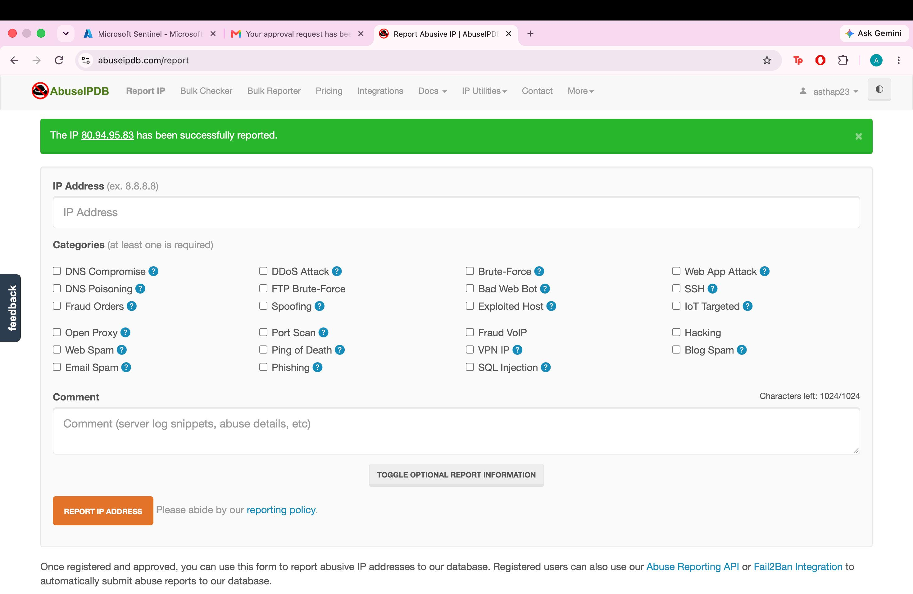

---

## 5. Detection rule

I created a scheduled analytics rule that runs every 5 minutes and looks back 1 hour. If one IP fails to log in 5 or more times, Sentinel creates a Medium-severity incident mapped to MITRE T1110, with the IP and host mapped as entities.

```kql
SecurityEvent
| where EventID == 4625
| summarize FailedAttempts = count(), Accounts = make_set(Account),
            FirstSeen = min(TimeGenerated), LastSeen = max(TimeGenerated)
            by IpAddress, Computer
| where FailedAttempts >= 5
```

**Testing:** I ran my own brute-force test (several wrong passwords in a row), and the rule created incidents automatically.

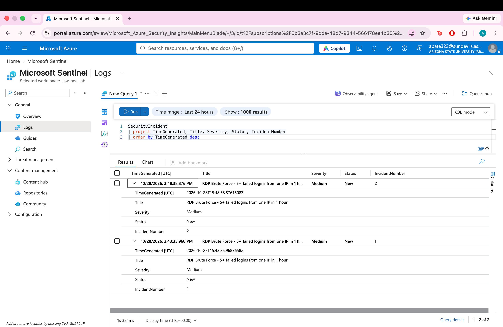

**Tuning:** The rule created duplicate incidents for the same test, because each 5-minute run looked back over the same hour. I turned on **suppression for 1 hour** after an alert fires, which stopped the duplicates.

The threshold of 5 is low on purpose, for testing. In production I would raise it and add an allow list for known admin IPs to reduce false positives.

---

## 6. Incident handling

All three test incidents were my own authorized activity, so I closed them as **Benign Positive – Suspicious but expected**, with a comment explaining the test. That means the detection worked correctly, but the activity was not a real threat.

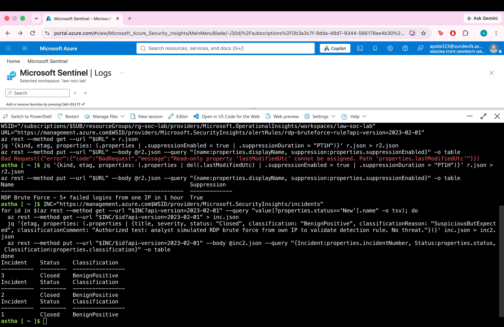

---

## What I learned

- How logs move from a Windows machine to a SIEM (agent, data collection rule, workspace).
- How to write KQL to find failed logins, top attackers, locations, and successful logins.
- How to check an IP's reputation with threat intelligence tools.
- How to build, test, and tune a detection rule, and why suppression matters for alert fatigue.
- How to classify and close incidents.
- An open RDP port gets found by real attackers within hours.

## Cleanup

To avoid charges, delete everything with one command:
```bash
az group delete -n rg-soc-lab --yes
```
